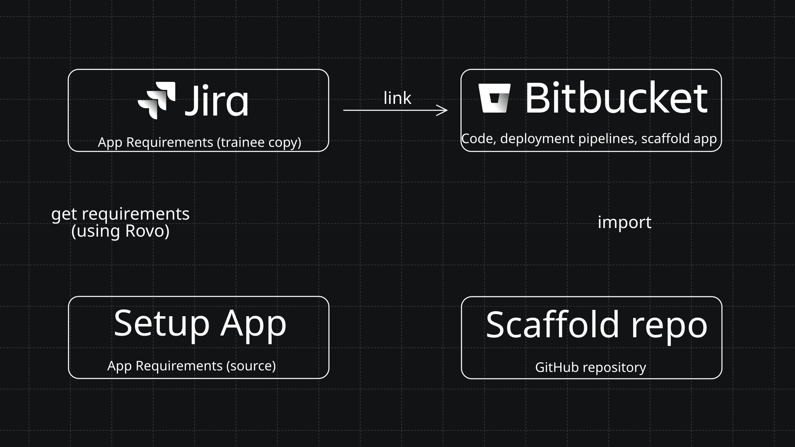
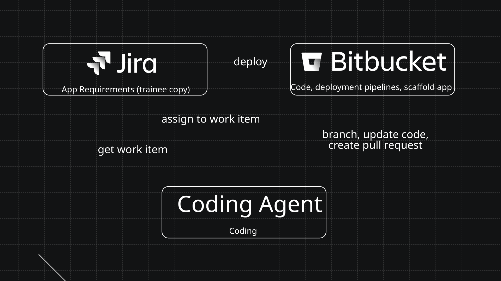

# Interactive Workflow — Forge App Training

Welcome! In this training session you will build a working **Atlassian Forge app** — entirely through your web browser, without writing a single line of code yourself.

You will use **Jira** to define what you want built, and an **AI agent** to implement it. Your job is to review the AI's work and merge it when you're happy with it. By the end of the session, you'll have a live, interactive app running inside Jira.

> **Jira and Bitbucket is your IDE.** No local development environment required.

---

## What you're building

The **Interactive Workflow** app is a Jira Global Page that lets users:

- Create named workflows made up of sequential steps
- Add instructional text to each step
- Include branch points where the user chooses between options and the workflow diverges
- Run workflows interactively, following one step at a time and tracking progress

It's a real, useful app — and you'll build it feature by feature, one Jira work item at a time.

---

## How it works

First you need to set up a Jira space and a Bitbucket repository. The Bitbucket repository will be set up by importing an existing repository which contains the scaffold of the app that will be built. The Jira space will be populated with story work items that specify what will be built.



Once set up, the training follows a simple software development lifecycle:

```
Assign story work item to coding agent  →  Coding agent implements it and creates a PR  →  Review & merge PR
```



Each feature of the app is already defined as a Jira **Story** in your space. To implement a feature:

1. Open the Story in Jira
2. Assign it to the **Jira Coding Agent**
3. Wait for the agent to open a Pull Request in Bitbucket
4. Review and merge the PR
5. The app automatically redeploys — your feature is live

Repeat for each Story, in order.

---

## A. Site Provisioning

The training requires you to have an Atlassian account and an Atlassian cloud site with the following products:

| Product | Purpose |
|---|---|
| **Jira** | Defines requirements as work items; hosts the finished app |
| **Bitbucket** | Hosts the app's source code and runs the CI/CD pipeline |
| **Rovo** | Powers the Jira Coding Agent that implements each work item |

Depending on how the training is organised, your facilitator may provision a site for you in advance. If so, you will receive:

- A site URL (e.g. `your-org.atlassian.net`)
- Login credentials or an invitation to join the site

> **Terminology used throughout these instructions:**
> - `your-org` — the subdomain of your Atlassian site (e.g. if your site is `acme.atlassian.net`, your org is `acme`)
> - `your-org.atlassian.net` — your full Atlassian site URL

**You've done this step when:** you can log in to `your-org.atlassian.net` and see Jira and Bitbucket in the top navigation.

---

## B. Setup Bitbucket

### Step B1 — Create your Bitbucket repository

Your Bitbucket workspace was provisioned as part of your Atlassian site. Create a repository pre-loaded with this scaffold using Bitbucket's built-in import feature — no git CLI needed.

1. Open **Bitbucket** and navigate to your workspace.
2. Click **+ → Import repository**.
3. Under **URL**, enter the URL of the public GitHub scaffold repository:
   ```
   https://github.com/dugaldmorrow/interactive-workflow-app-scaffold.git
   ```
4. Give the repository the name `interactive-workflow-app`.
5. Click **Import repository**. Bitbucket clones the scaffold — including `bitbucket-pipelines.yml` — directly into your workspace.

**You've done this step when:** you can see the `interactive-workflow-app` repository in Bitbucket with files including `manifest.yml` and `bitbucket-pipelines.yml`.

---

### Step B2 — Configure repository variables

The CI/CD pipeline needs your Atlassian credentials to deploy the app. Store them as secured repository variables — they are never visible after saving.

> If you see the warning **"Pipelines must be enabled on this repository before you can add Repository variables"**:
> 1. Click **Pipelines** in the left sidebar.
> 2. Click **Enable Pipelines**.
> 3. Return to **Repository settings → Repository variables**.

1. In your Bitbucket repository, go to **Repository settings → Repository variables**.
2. Add the following variables:

   | Variable | Value | Secured? |
   |---|---|---|
   | `FORGE_EMAIL` | Your Atlassian account email address | No |
   | `FORGE_API_TOKEN` | An Atlassian API token (create one at [id.atlassian.com/manage-profile/security/api-tokens](https://id.atlassian.com/manage-profile/security/api-tokens)) | **Yes** |
   | `FORGE_DEVELOPER_SPACE_ID` | **Developer Space ID (UUID)** — not the space name. See note [^developer-space-id]. | No |
   | `SITE_URL` | Your Atlassian site URL, e.g. `mysite.atlassian.net` | No |

[^developer-space-id]: You can find your Developer Space ID either:
- **From the Forge developer console:** [developer.atlassian.com/console/myapps/](https://developer.atlassian.com/console/myapps/) → select a space in the left sidebar **DEVELOPER SPACE** selector, then copy the ID from the URL (or the space details pane if shown).
- **From the Forge CLI:** run `forge developer-spaces list` and copy the value from the **ID** column for your space name.

**You've done this step when:** all four variables are listed under Repository variables.

---

### Step B3 — Register the app

This step gives the app a unique ID in the Atlassian ecosystem. It only needs to be done once.

1. In your Bitbucket repository, go to **Pipelines** in the left sidebar.
2. Click **Run pipeline**.
3. In the **Branch** dropdown, select **main**.
4. Under **Pipeline**, select **Custom: register-app**.
5. Click **Run**. The pipeline installs the Forge CLI and runs `forge register`.
6. When the pipeline completes, open the pipeline log and find the updated `manifest.yml` output — it will contain a real app ID (starting with `ari:cloud:ecosystem::app/...`).
7. The pipeline commits the updated `manifest.yml` back to the repository automatically.

**You've done this step when:** the `register-app` pipeline shows a green tick and `manifest.yml` in your repository contains a real app ID.

---

### Step B4 — Deploy and install the app

Now deploy the scaffold app to Forge and install it on your Jira site.

You will install **two Forge environments**:

- **Development**: where you can test changes before you approve/merge Pull Requests.
- **Production**: what everyone uses after changes are merged to `main` (this deploys automatically on merge).

#### Step B4a — Install the development environment (for testing)

1. In your Bitbucket repository, go to **Pipelines**.
2. Click **Run pipeline**.
3. In the **Branch** dropdown, select **main**.
4. Under **Pipeline**, select **Custom: install-app-dev**.
5. Click **Run**.

**You've done this step when:** the `install-app-dev` pipeline shows a green tick.

#### Step B4b — Install the production environment (the “real” app)

1. In your Bitbucket repository, go to **Pipelines**.
2. Click **Run pipeline**.
3. In the **Branch** dropdown, select **main**.
4. Under **Pipeline**, select **Custom: install-app**.
5. Click **Run**.

**You've done this step when:** the `install-app` pipeline shows a green tick.

#### Step B4c — Verify both app environments are visible in Jira

Once both pipelines have completed successfully, confirm that both environments appear in Jira:

1. In Jira, click **Apps** in the left sidebar.
2. You should see **two** entries for your app:
   - **Interactive Workflow** — the production environment (no lozenge).
   - **Interactive Workflow** with a **`Dev`** lozenge — the development environment.

> If you only see one entry, check that both `install-app-dev` and `install-app` pipelines completed with a green tick.

**You've done this step when:** both **Interactive Workflow** entries are visible in the Jira sidebar.

---

### Step B5 — Connect Bitbucket to Jira (DVCS accounts)

This connection allows Jira (and the Jira Coding Agent) to see your Bitbucket branches and Pull Requests.

1. In Jira, click the **cog (⚙️)** in the top right.
2. Select **Jira apps**.
3. In the left sidebar, select **DVCS accounts**.
4. Click **Link Bitbucket Cloud workspace**.
5. Select the appropriate workspace from the dropdown.
6. Click **Grant access**.
7. You’ll be redirected — click **Grant access** again.
8. You’ll be redirected back — click **Got it**.

**You've done this step when:** your Bitbucket workspace appears in **DVCS accounts** and Jira starts showing Bitbucket activity in the **Development** panel on work items.

---

## C. Setup Jira

### Step C1 — Create your Jira space

In Jira, you’ll create a dedicated **space** for the training so you have a board/backlog to track progress.

1. In Jira, click **Spaces** in the left sidebar.
2. Click **Create space**.
3. Select **Scrum** as the template.
4. Choose **Team-managed** when asked about management style.
5. Name the space **Interactive Workflow** and note the key Jira suggests (e.g. `IW`) — you’ll need it in the next step.
6. During setup, when you reach the step **Add agents to your workflow**, ensure **Jira Coding Agent** is enabled/added.
   - You may also see options for connecting other tools/agents (for example, *Claude for Jira*, *Cursor*, or *GitHub Copilot*).
   - For this training, **you do not need to connect any third-party coding tools** — just make sure **Jira Coding Agent** is available so you can assign work items to it.
   - Jira may also create a couple of extra "connect an agent" onboarding tasks in your backlog during this setup. If that happens, **leave them as-is** and continue — the actual Interactive Workflow feature work items are created in **Step C2**.
7. Click **Create**.

**You've done this step when:** you can open the space and see an empty board/backlog.

---

### Step C2 — Populate the space with work items

Use Rovo to create all the work items that define the app's features automatically.

**Open Rovo Chat** (click the Rovo icon in the top navigation bar in Jira) and paste the following prompt, replacing `[SPACE-KEY]` with the key from Step C1:

```
Create Jira work items in space [SPACE-KEY] based on the specification at
https://go.atlassian.com/get-workflow-app-specification

Create the work items using the workItemType field (Epic vs Story).

Create the Epic first, then create each Story within the Epic.

Use the dependsOn field to create "is blocked by" links between Stories.
```

Rovo will fetch the specification and create 1 Epic and 10 Stories in your space, including the dependencies between the Stories. This takes about a minute.

**You've done this step when:** your Jira board shows an Epic plus 10 Stories in the **To Do** column.

---

### Step C3 — Verify the app is installed

Before implementing any features, confirm the scaffold app is running on your Jira site.

1. In Jira, click **Apps** in the top navigation bar.
2. Look for **Interactive Workflow** in the list.
3. Click it — you should see the two-panel layout with **Workflow Library** on the left and **Workflow Runner** on the right (both showing placeholder text for now).

> If you don't see the app, check that the `install-app` pipeline in Step B4 completed successfully.

**You've done this step when:** you can see the Interactive Workflow app in Jira with its two-panel layout.

---

### Step C4 — Explore your board

Take a moment to look around your Jira space before starting to implement.

1. In Jira, click **Spaces** in the left sidebar and open your **Interactive Workflow** space.
2. Click **Board** in the left sidebar. You should see your 10 Stories in the **To Do** column.
3. Click on any Story to read its description and acceptance criteria — this is exactly what the AI agent will read when implementing it.
4. Notice the **"is blocked by"** links on some Stories — these show which features depend on which. Implement Stories roughly in the order they appear (lower numbers first).

---

## D. Implement the App

### Step D1 — Implement the next feature

The story **Scaffold the Forge Global Page app with a two-panel layout** is already implemented — it's the scaffold you set up in Section A (the two-panel layout). If you haven't already, update its status to "Done". The next feature to be implemented should have the lowest work item key - **Add the ability to create a new named workflow**, then **Add the ability to add sequential steps to a workflow**, etc.

1. Open the next story to be implemented. 
2. Click the **Assignee** field.
3. Select **Jira Coding Agent** from the user picker.
4. If Jira prompts you to connect the agent to a repository:
   - Select your Bitbucket repository (e.g. `interactive-workflow-app`).
   - Ensure the option to **Create a pull request** is checked (it may be unchecked by default).
5. Update the Story status to **In Progress**.
   - In some Jira setups, assigning the Story to the agent does **not** automatically move it.
6. The agent starts working.
7.  (Optional) Click **View session** (or **View agent session**) to open the coding agent’s live session.
   - This lets you monitor progress (what it’s reading, planning, and changing) while it works.
   - The agent can take a few minutes, so the session view is the best place to see ongoing activity.

> The agent reads the Story's description and acceptance criteria, writes the code, and opens a Pull Request in Bitbucket. This typically takes 2–5 minutes (sometimes longer).

**You've done this step when:** a Pull Request appears in Bitbucket.

> If your Story status hasn't moved automatically, update it to **In Review** once the PR is opened.

---

### Step D2 — Review and merge the Pull Request

When the Jira Coding Agent finishes, it opens a Pull Request (PR) in Bitbucket and links it to the Story.

1. Open the Story in Jira — you'll see a linked PR in the **Development** panel on the right.
2. Click the PR link to open it in Bitbucket.
3. Read the PR description — the agent explains what it built and why.
4. Click **Diff** to see the code changes. You don't need to understand every line — look for the broad shape of the change.
5. (Optional) If you want to test the feature, run the Bitbucket Pipeline "Deploy Forge App (development)", wait for it to finish and then test the development environment version of the app.
6. If you're happy with it, click **Merge**.
7. After merging, Bitbucket Pipeline **Deploy and Install Forge App (production)** will automatically run to update the production version of the app in your Jira site. Monitor the pipeline.
8. If the **Deploy and Install Forge App (production)**, visit the **What to do if the AI gets it wrong** below.
9. Reload the production version of the app and test it.

**You've done this step when:** you can open **Apps → Interactive Workflow** in Jira and see the new feature working.

---

### Step D3 — Iterate

Repeat Steps D1 and D2 for each remaining Story, working roughly in order:

| Story | Feature | Depends on |
|---|---|---|
| 2 | Create a new named workflow | 1 |
| 3 | Add steps to a workflow | 2 |
| 5 | Implement the Workflow Runner | 2 |
| 4 | Add branch steps | 3 |
| 7 | Add a progress indicator | 5 |
| 8 | Persist workflows using Forge Storage | 3 |
| 6 | Extend the runner to handle branches | 4, 5 |
| 9 | Edit and delete workflows and steps | 3 |
| 10 | Workflow Complete screen | 5 |

> **Tip:** You can assign multiple Stories to the agent at the same time if they don't depend on each other. For example, Stories 4 and 5 both depend on Story 3 — once Story 3 is merged, you can assign both 4 and 5 simultaneously.

---

## What to do if the AI gets it wrong

The agent isn't perfect. 

1. If a PR doesn't look right or the feature doesn't work as expected:
   1. **Don't merge it.** Leave the PR open.
   2. Go back to the Jira Story and add a comment explaining what's wrong. Be specific — describe what you expected and what actually happened.
   3. The agent will read your comment, update the PR, and push new changes.
   4. Review again and merge when satisfied.
2. If the **Deploy and Install Forge App (production)** fails, it could be because the app was changed in a way that requires approval before it can be updated so you'll need to manually run the **Upgrade Forge App (production)** Bitbucket Pipeline. 

Alternatively, you can **decline the PR** and re-assign the Story to the agent for a fresh attempt.

---

## Checking your app

At any point, open **Apps → Interactive Workflow** from the Jira top navigation to see your app in its current state. Each merged PR adds new capability — you'll see the app grow feature by feature.

---

## Finished?

Once you've merged all 10 Stories, you have a fully working Interactive Workflow app. Try it out:

1. Create a workflow with a few sequential steps and run it from start to finish.
2. Create a workflow with a branch step and follow different paths.
3. Reload the page — your workflows should still be there (once Story 8 is merged).

Congratulations — you've just shipped a real Atlassian Forge app, using AI-assisted development, without writing a line of code.

---

## About this repository

This repository is the **scaffold** for the Interactive Workflow app. It contains:

| File | Purpose |
|---|---|
| `manifest.yml` | Forge manifest declaring the Jira Global Page module |
| `package.json` | App dependencies |
| `tsconfig.json` | TypeScript configuration |
| `bitbucket-pipelines.yml` | CI/CD pipeline: auto-deploys on merge to `main`; manual `register-app` and `install-app` pipelines for initial setup |
| `src/resolver.ts` | Backend resolver (expanded by each work item) |
| `src/frontend/index.tsx` | Frontend entry point (two-panel scaffold) |

Each work item implemented by the AI agent adds to or modifies these files via a Pull Request.
